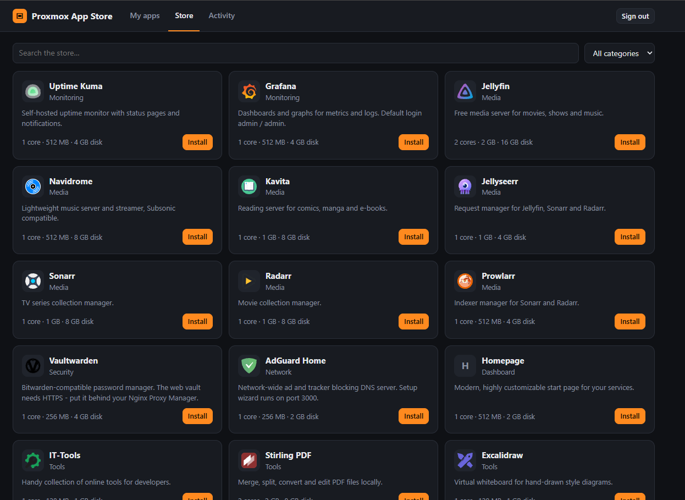

# Proxmox App Store

A small web UI for a Proxmox VE host that runs in its own LXC container.

- **My apps** – see all your containers and virtual machines with status, CPU, memory and IP address. Start, stop, restart and delete them.
- **Store** – install an app with one click. Each app becomes a new container created from a Docker/OCI image. About 100 apps are included (Jellyfin, Uptime Kuma, Vaultwarden, Nextcloud, n8n and more), and you can install any other image with "Custom image".

It has no dependencies beyond Node.js, and it talks to Proxmox with a limited API token, not your root password.

## Screenshots

**Store** – pick an app and click Install:



## Requirements

- Proxmox VE **9.1 or newer** (the store uses Proxmox's support for OCI images, which older versions don't have)
- A single Proxmox node (on a cluster, the app only manages the first node)
- A network bridge with DHCP, normally `vmbr0` – installed apps get their address from your router
- Internet access from the Proxmox host, to download app images

## Install

The install takes about ten minutes. You create one small container, put the app in it, and connect it to Proxmox.

### 1. Create a container for the App Store

In the Proxmox web UI:

1. Go to your storage (usually **local**) → **CT Templates** → **Templates**, and download **debian-13-standard**.
2. Click **Create CT** and fill in:
   - **Hostname:** `appstore`, and a root password
   - **Template:** the Debian 13 template you just downloaded
   - **Disk:** 4 GB
   - **CPU:** 1 core
   - **Memory:** 512 MB
   - **Network:** bridge `vmbr0`, IPv4 **DHCP**
3. Tick **Start after created** and finish.
4. Select the new container → **Options** → set **Start at boot** to Yes.

### 2. Install the app in the container

Open the container's **Console**, log in as `root`, and paste:

```sh
apt update && apt install -y nodejs git
git clone https://github.com/nikolajalbrechtsen/proxmox-appstore.git /opt/appstore
useradd -r -s /usr/sbin/nologin appstore
mkdir -p /var/lib/appstore && chown appstore: /var/lib/appstore && chmod 700 /var/lib/appstore
cp /opt/appstore/appstore.service /etc/systemd/system/
systemctl daemon-reload && systemctl enable --now appstore
hostname -I
```

The last command prints the container's IP address. You need it in step 4.

### 3. Create an API token on the Proxmox host

Open the **host's** shell (select your node in the left tree → **Shell**) and paste:

```sh
pveum role add AppStore -privs "VM.Allocate,VM.Audit,VM.PowerMgmt,VM.Config.Disk,VM.Config.CPU,VM.Config.Memory,VM.Config.Network,VM.Config.Options,VM.GuestAgent.Audit,Datastore.AllocateSpace,Datastore.AllocateTemplate,Datastore.Audit,Sys.Audit,Sys.AccessNetwork,SDN.Use"
pveum user add appstore@pve
pveum acl modify / -user appstore@pve -role AppStore
pveum user token add appstore@pve web --privsep 0
```

The last command prints a table. Copy the long code in the **value** row. It is shown only once.

This creates a separate `appstore@pve` user that can manage containers and VMs but cannot change users, permissions or host settings.

### 4. Connect the app to Proxmox

Open `http://<container IP>` in your browser. On the setup page, enter:

- **Proxmox host** – the IP address of your Proxmox host
- **Token ID** – `appstore@pve!web`
- **Token secret** – the value you copied in step 3
- **Password** – choose one, at least 8 characters. You sign in to the App Store with it.

Click **Connect**. You should see your containers and VMs under **My apps**.

Do this right after step 2: until setup is finished, anyone on your network who opens the page can complete it.

### 5. Try it

Go to **Store**, install **Whoami** (a tiny test app) and click **Open** when it finishes. Then stop and delete it from **My apps**.

## Installing apps

Click an app card in the **Store** to see what it is, with screenshots where the project provides them. **Install** asks only for a name and size, and the defaults work.

**Advanced options** in the install dialog let you also choose:

- the Docker image version (for example `:1.23` instead of `:latest`)
- the container ID, storage and network bridge
- a static IP address and gateway instead of DHCP
- swap, extra environment variables, and whether the app starts at boot or right after installing

## Good to know

- **The App Store's address comes from DHCP** and can change. Reserve it in your router, or give the container a static IP.
- **It uses plain HTTP.** Keep it on your local network, or put it behind a reverse proxy with HTTPS. Don't expose it directly to the internet.
- **Not every Docker image works** as a Proxmox container. If an app stops right after starting, the Activity tab says so. Apps that need several containers (a separate database, for example) are not in the catalog.
- **Passwords for installed apps:** some apps get a generated password in the install dialog. Note it down before you click Install.
- **The App Store cannot stop or delete its own container.** Do that from the Proxmox UI.
- **Settings are stored in `/var/lib/appstore`** in the container: the API token, your password hash and the list of installed apps.

## Updating

Update manually, in the App Store container's console:

```sh
cd /opt/appstore && git pull && systemctl restart appstore
```

Or update automatically. This makes the container check GitHub every minute and restart the app when `main` changes:

```sh
cp /opt/appstore/autoupdate/appstore-update /usr/local/bin/ && chmod +x /usr/local/bin/appstore-update
cp /opt/appstore/autoupdate/appstore-update.service /opt/appstore/autoupdate/appstore-update.timer /etc/systemd/system/
systemctl daemon-reload && systemctl enable --now appstore-update.timer
```

Automatic updates run whatever is pushed to the repository you cloned, with access to your Proxmox token. If you don't control that repository, fork it and clone your fork instead.

A commit whose `server.js` or `catalog.json` doesn't parse is skipped, and the running version is kept. See what the updater did with `journalctl -u appstore-update -n 20`; the line `Updated to <commit>` confirms each update.

## Adding your own apps

Add an entry to `catalog.json`:

```json
{ "id": "uptime-kuma", "name": "Uptime Kuma", "category": "Monitoring", "icon": "uptime-kuma",
  "desc": "Self-hosted uptime monitor.", "image": "louislam/uptime-kuma:1", "port": 3001,
  "cores": 1, "memory": 512, "disk": 4,
  "env": [ { "key": "TZ", "label": "Time zone", "value": "Europe/Copenhagen" } ] }
```

| Field | Meaning |
| --- | --- |
| `image` | Docker/OCI image. Docker Hub is assumed when no registry is given. |
| `port` | Port of the web UI, used for the Open button. Use `0` for apps without one. |
| `path` | Optional path added to the Open link, such as `/web`. |
| `cores`, `memory`, `disk` | Default resources. Memory is in MB, disk in GB. |
| `env` | Optional settings shown in the install dialog and passed to the app as environment variables. `{{hex16}}` or `{{hex64}}` in a value becomes a random string of that length. |
| `icon` | Icon name from [dashboard-icons](https://github.com/homarr-labs/dashboard-icons). |
| `repo` | Optional GitHub repository (`owner/name`), shown as the Source link in the app's details. |
| `screenshots` | Optional list of image URLs shown in the app's details. |

`node tools/screenshots.js` fills in `repo` and `screenshots` for the whole catalog and checks that every image loads. It looks in each project's README on GitHub first, then in the CasaOS and Umbrel app-store galleries, then on the project's website. To refresh only some apps, add their ids: `node tools/screenshots.js jellyfin gitea`. To fill in only the apps that have none: `node tools/screenshots.js --missing`. For a new app, add its repository to the list at the top of that file first.

Restart the app afterwards (`systemctl restart appstore`).

## Troubleshooting

- **The page doesn't load:** check the app in the container with `systemctl status appstore` and `journalctl -u appstore -n 30`.
- **"Proxmox: Permission check failed" on an action:** the token is missing a privilege. Compare the role with step 3 (`pveum role list` on the host).
- **Forgot the password, or want to connect to another host:** delete `/var/lib/appstore/config.json` in the container and run `systemctl restart appstore`. The setup page appears again.
- **An install fails while downloading:** Docker Hub limits anonymous downloads. Wait a while and try again.
